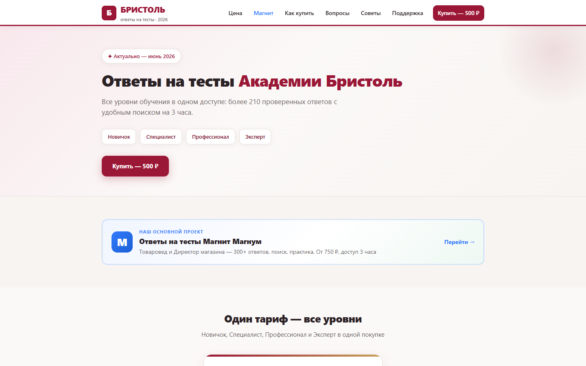
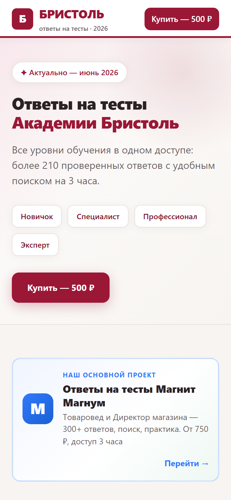
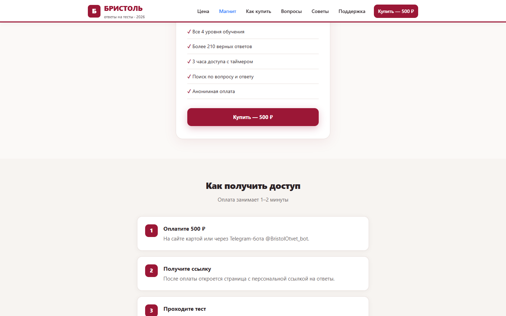

# Bristol-Test — showcase

| | |
|--|--|
| 🌐 Live | https://bristol-test.ru/ |
| Status | **In production / в проде** |

## Скриншоты / Screenshots





---

## 🇷🇺 Русский

### О проекте
Платный портал **ответов на тесты Академии Бристоль**: уровни обучения, каталог/поиск вопросов, **оплата**, **временный доступ** к материалам. Связан с продуктом Magnit (общий webhook ЮKassa).

### Что сделано
- SEO-лендинг с уровнями (новичок → эксперт)
- Оплата картой через **ЮKassa**
- Webhook + страница успеха
- Токен доступа и просмотр с поиском
- Таймер / ограничение сессии
- Уведомления в Telegram
- Кросс-ссылки на Magnit

### Стек: что за что

| Часть | Технологии | Для чего |
|--------|------------|----------|
| Витрина | PHP + HTML (`index.php`) | Лендинг, CTA, SEO-контент |
| UI | CSS, JavaScript | Модалки, UX покупки |
| Оплата | PHP + **ЮKassa** | `buy.php`, `webhook.php`, `success.php` |
| Доступ | PHP | `access.php`, `view.php`, `check.php` — токен и просмотр |
| API | PHP `api/` | Создание токенов, notify |
| Конфиг | `includes/` (placeholders) | URL, DB, ЮKassa, Telegram |
| SEO | robots, sitemap, Метрика | Трафик |

### Поток
```
Лендинг → ЮKassa → webhook → токен → поиск/просмотр → конец сессии
```

### Код
Коммерческий проект: исходный код закрыт и хранится в приватном репозитории. Здесь — описание, стек и скриншоты.

---

## 🇬🇧 English

### About
Paid portal for **Bristol Academy test answers**: learning levels, Q&A catalog/search, **checkout**, and **time-limited access**. Shares a YooKassa webhook store with the Magnit product.

### What was built
- SEO landing with levels (novice → expert)
- Card payments via **YooKassa**
- Webhook + success page
- Access tokens + searchable content view
- Session timer / expiry
- Telegram purchase alerts
- Cross-links to Magnit product

### Stack: what each layer is for

| Layer | Tech | Purpose |
|--------|------|---------|
| Storefront | PHP + HTML | Landing, CTA, SEO content |
| UI | CSS, JavaScript | Purchase modal UX |
| Payments | PHP + **YooKassa** | Checkout, webhook, return |
| Access | PHP | Tokens, view, session checks |
| API | PHP `api/` | Token issue, notifications |
| Config | `includes/` (placeholders) | URLs, DB, YooKassa, Telegram |
| SEO | robots, sitemap, Metrika | Organic traffic |

### Flow
```
Landing → YooKassa → webhook → token → search/view → session ends
```

### Code
Commercial project: the source is private. This repository is a showcase — overview, stack and screenshots.

---

**Author:** [Ruslan Kovalchuk](https://github.com/Arctillect-RK) · [Telegram](https://t.me/Arctillect)
